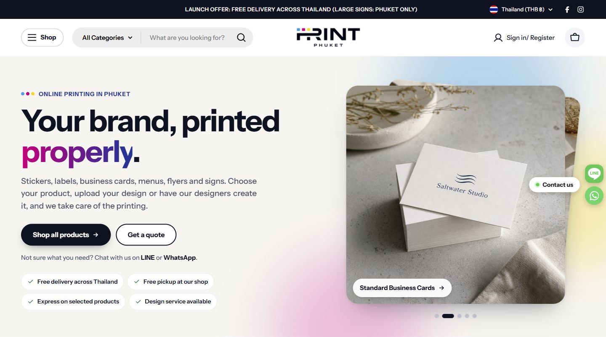
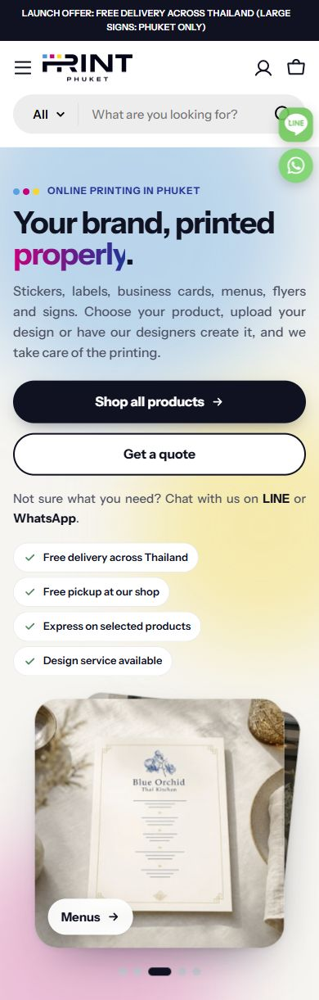
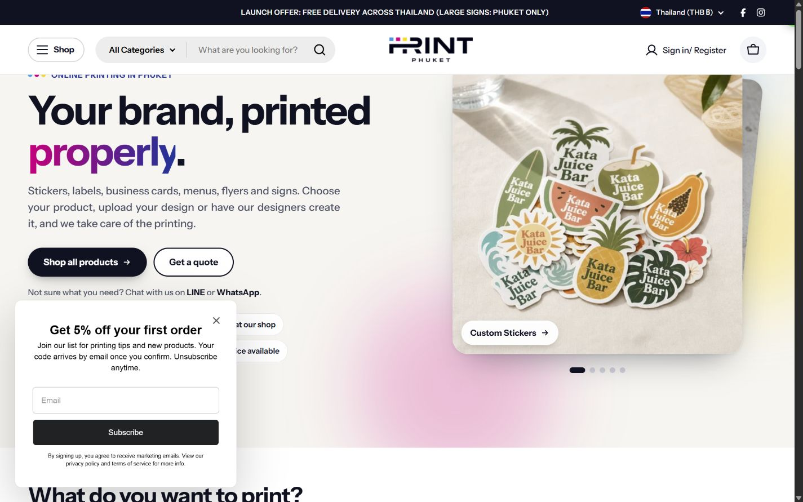

# Print Phuket: design, layout and UX study

Observed 17 November 2026. Sources: [homepage](https://printphuket.com/), [custom stickers](https://printphuket.com/products/custom-stickers), [custom quote](https://printphuket.com/pages/get-a-quote).

This study supplements ten desktop/mobile pattern records in [the rich catalogue](patterns/printphuket-2026-11-17.json). Open [the visual gallery](pattern-gallery.html) and search “Print Phuket” for section evidence and rebuild recipes. These are observed references, not rebuild-validated components or measured conversion results.

## What makes the design useful

The site has a practical commercial model: browse standard products, explain a bespoke job, or ask for help. Photography is the visual language of the offer, not a background decoration. A business can recognise menus, packaging labels, business cards and signage from finished applications before understanding the production vocabulary.

The major lesson is to combine an intelligible buying route with a rich asset system. The homepage contains multiple grids, but relevant images, different scales and different content roles keep them from feeling like the same paragraph-card section repeated indefinitely. The useful pattern is content-specific composition and consistent art direction; there is no need to copy every grid or colour treatment.

## Desktop hero: an animated catalogue, not a background slideshow

The copy remains stable on the left. On the right, five product/application photo cards occupy one fixed stage. The front card is legible and nearly upright; neighbouring cards remain partly visible at smaller scales and opposing rotations. Each front image has an attached product label and destination, so the animation offers discovery rather than merely atmosphere. Named dot controls provide a manual route through the same collection.

Observed active/inactive DOM states and computed transforms support this interpretation: cards are absolutely positioned, with an approximately 0.9-second transform and 0.7-second opacity transition. Two neighbour states were approximately −7° at .86 scale and +6° at .88 scale, with lateral offsets. The dwell interval and pause/reduced-motion implementation were not measured. [Another captured state](shots/printphuket-hero-desktop-state3.jpg) and [a viewport state](shots/printphuket-hero-desktop-state2.jpg) supplement the primary composition; stills do not establish the complete motion choreography.

**Rebuild plan**

- Use one data item per product: image, accessible description, visible label and URL.
- Keep a relative stage with a stable aspect ratio and absolute card links. Assign active, previous, next and hidden positions around one index.
- Move cards with transform/opacity while maintaining readable layering and a clean hit target. Inactive cards should not intercept clicks or keyboard traversal.
- Let manual selection pause the automatic sequence; pause on focus, relevant pointer interaction and document hiding. Provide a manual/static reduced-motion version.
- Preserve early shop and enquiry routes independently of the carousel. Loading failures should leave useful copy and a poster/fallback.
- Implement as an editable Webflow component with scoped state, or an Astro-rendered card list with a small interactive controller. A costly generated background video is unnecessary.

This is a proposal for adapting the observed composition, including improvements; it is not extracted source code.

## Mobile hero tradeoff

The phone order is copy → primary/secondary actions → reassurance → photo stack → pagination. The full captured hero is about 1,221 px tall at the requested 390×844 viewport. Enquiry and shopping remain available early, but the first screen does not show the product-card showcase. Preserve this choice only when action clarity is more important than immediate visual recognition; otherwise shorten the copy/reassurance or introduce a smaller image higher.

Some early screenshots have a 375×812 raster because of browser rendering/scaling. The final full hero and section crops use a 390 px capture width. Desktop section captures use 1440 px; a supplementary full homepage was captured earlier at 1264 px.

## Asset direction: why the photos belong together

The strongest visual consistency comes from warm, soft lighting, tactile paper/stone/linen surfaces, restrained props and convincing product scale. Each scene communicates a different application while remaining part of a family. Reusing those applications in category cards and product pages creates recognition.

For a new site, prepare an asset matrix with each image's job, subject, crop and destination. Source or make a representative family member before commissioning the whole set. Match light, surface, camera language and prop density; give every product a recognisable silhouette. Verify details such as typography, printing edges and material behaviour.

The source's image production methods were not independently established; its product page labels imagery as illustrative. Do not assume these are documentary photographs of completed customer work. Rebuild the art direction with original/appropriately licensed assets rather than copying files or another brand's artwork.

## Coordinated card feedback

The designer specifically reported a three-part hover effect: the photograph zooms, a narrow colour line appears/moves, and the arrow advances. Record these as one coordinated interaction. An automated pointer-hover sequence and exact source timing were not captured during this inspection.

For an adaptation, keep the text/body stable and clip the image to its own rounded media region. A modest scale around 1.03–1.06, arrow movement around 4–6 px and a 200–350 ms shared timing are starting proposals to test, not measured source values. Let the line use the brand's accent; a rainbow makes sense for a print brand but is not a universal default.

Carry the feedback into keyboard focus-visible and reduce nonessential motion when requested. Pointer activation must not leave a decorative focus halo. The line is transient action feedback on meaningful photographic content; avoid turning it into a permanent coloured edge strip on generic cards.

## Discount teaser and email capture

A small reopenable discount teaser becomes a compact lower-corner email panel. It offers a specific first-order incentive, one email field, a subscription action, a clear close control and an explanation that the code follows email confirmation. This is an additional acquisition goal for visitors who are not ordering immediately, separate from the primary shopping and quote paths.

**Observed:** the panel appeared during browsing; its close control returned to a teaser; Enter on the teaser reopened it. No email was entered or submitted. In one Escape attempt, the panel remained present. Mobile popup rendering, focus containment, delivery of a code and subscription completion were not verified. [Teaser evidence](shots/printphuket-discount-teaser-desktop.jpg) is saved separately.

**Adaptation:** agree a genuine incentive and the purpose of the signup first. Offer an explicit launcher and restrained initial timing; make dismissal persistent enough to respect the visitor. Prevent overlap with primary actions and chat launchers on small screens. Support labels, validation, success/error states, keyboard close and focus restoration. Test the actual email-confirmation/code-delivery journey. A printing coupon should not be imported into a home-service site without a suitable real offer.

This component is documented with desktop-only evidence here; the gallery's phone-tested CTA record refers to the separate closing quote band, not this popup.

## Page layout and section jobs

| Observed section | What it helps the visitor do | Useful design decision |
| --- | --- | --- |
| Hero | Recognise the offer and choose shop, custom quote or help | Stable persuasive copy plus linked photo stack |
| Category grid | Select the product family | Large application images with short scope descriptors |
| Bestseller carousel | Start with a familiar product | Product imagery and concise order routes |
| Ordering process | Understand what happens and where proof approval fits | Four icon stages; optional proof clearly distinguished |
| Testimonials | Inspect customer feedback presented by the site | Central emphasis with peripheral quotes; authenticity was not independently checked |
| Design-service section | Continue even without finished artwork | Service-specific photographic outcomes and direct actions |
| Business discovery | Find suitable products by use case | Compact image-and-label industry doors |
| Journal | Resolve relevant buying/production questions | One featured photographic guide with a supporting story rail |
| FAQ | Resolve remaining pre-order objections | Short, purchase-relevant disclosures |
| Custom-work close | Enquire about work outside standard options | One dominant quote route with contact alternatives |
| Footer | Find practical contact, help and navigation | Contact directory plus oversized brand signature |

An older compact bank entry calls the bestseller strip “tabbed.” The inspected version showed product-carousel controls; category words below cards were not evidence of a tab-filter interaction. Use the dated rich records and captures for the current appearance.

## Navigation and route design

The menu offers product and business discovery rather than one long undifferentiated list. Desktop uses a dark multi-region panel with a mode rail, visual categories and featured/quote support. Phone uses image-led product choices and a business drill-in view with Back. Search and quote routes remain available.

The homepage can support these journeys:

1. Recognise an application → choose a category/product → configure a standard order.
2. Identify a bespoke requirement → enter the quote page → choose a project type → provide an enquiry.
3. Arrive unsure → use appropriate product guidance, design support or a contact channel.
4. Defer buying → optionally join the email offer.

Only the entry and some intermediate UI states were inspected. No checkout, purchase, enquiry, subscription, chat message or file upload was completed.

## Product and quote-page findings

The sticker page combines a large product gallery with value/use-case context and numbered options, artwork and review stages. Selecting Square produced a selected state; this does not establish that all variant pricing, uploads or cart payloads work. The staged configurator is useful to adapt only when real product complexity warrants it.

The quote page pairs custom-work copy and a lightweight illustrative status card with category choices and process/preparation guidance. Selecting the signs category changed the quote label and exposed a Monday form iframe/loading state. Loaded fields and submission were not verified. Chat and open-form fallbacks reduce reliance on that embed.

The narrow quote-page capture shows several clipped or over-wide elements. Rebuild with bounded containers, wrapping controls, min-width:0 where needed and a tested iframe fallback. Do not reproduce the overflow. Floating chat controls can also compete with the top search/header region on phones.

## What to borrow and what to improve

**Borrow:** meaningful photography; a linked, controlled card stack; direct standard/custom buying routes; product/use-case navigation; coordinated media-and-arrow feedback; purpose-led support sections; and a coherent asset family across the journey.

**Improve when adapting:** phone showcase placement where needed, popup timing and Escape/focus behaviour, interaction predictability, text wrapping/spacing, quote-page overflow, lazy-image loading evidence and an end-to-end verified form/order path. Some saved navigation frames include transition/focus states; they are not proof of final keyboard quality.

The source's trade dress, images, copy, logos and operational promises are not reusable project assets. Editorial conversion-clarity and visual-impact scores describe this inspection, not measured business performance.

